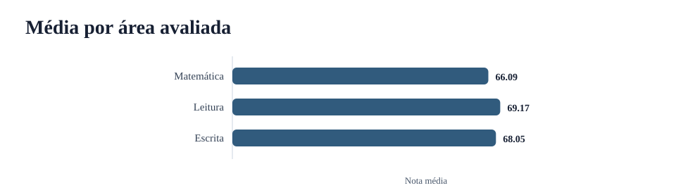
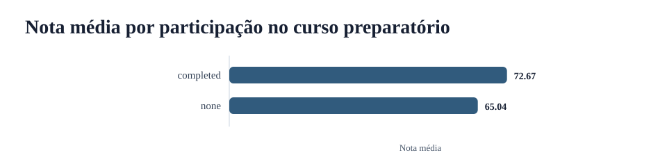
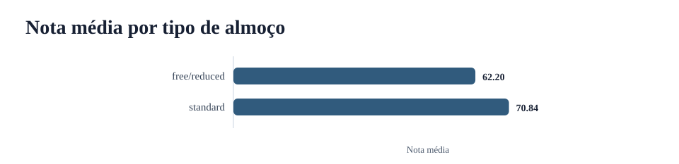
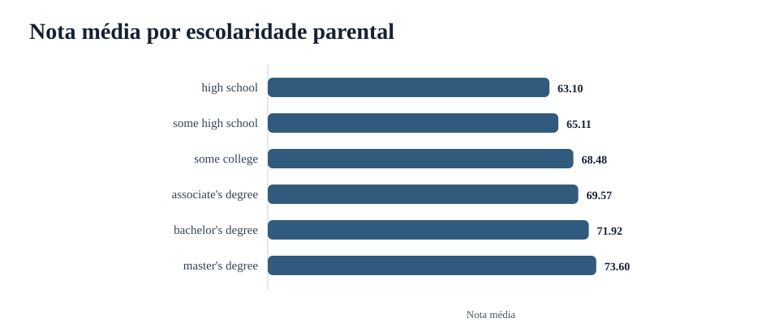
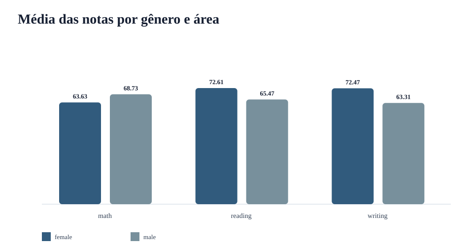
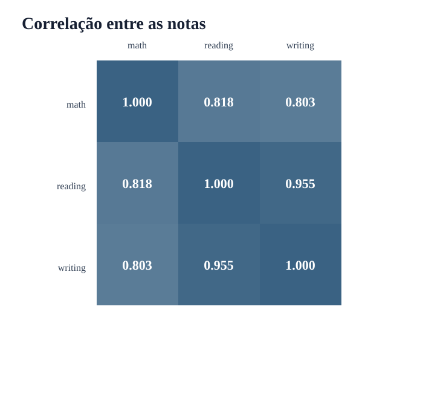

# Desempenho Estudantil — Análise Exploratória com Python

Projeto estudantil de portfólio em **Análise de Dados com Python** voltado à exploração de fatores associados ao desempenho em matemática, leitura e escrita.

## Pergunta central

**Quais características estão associadas às diferenças de desempenho dos estudantes nas três áreas avaliadas?**

O projeto é descritivo e comparativo. As relações encontradas são tratadas como **associações**, não como efeitos causais.

## Dataset

A base contém:

- **1.000 estudantes**
- **8 variáveis originais**
- **0 valores ausentes**
- **0 duplicatas completas**

| Variável | Descrição |
|---|---|
| gender | gênero informado na base |
| race/ethnicity | grupo anonimizado A–E |
| parental level of education | escolaridade parental |
| lunch | tipo de almoço |
| test preparation course | participação em curso preparatório |
| math score | nota de matemática |
| reading score | nota de leitura |
| writing score | nota de escrita |

A base corresponde ao conhecido dataset **Students Performance in Exams**. O arquivo incluído em `data/raw/` reproduz a base usada nesta análise.

## Métricas criadas

Durante a análise são criadas duas métricas derivadas:

- `average score`: média simples das três notas;
- `passed_all_60`: indicador didático que identifica estudantes com nota mínima de 60 nas três áreas.

O segundo indicador é apenas uma regra analítica do projeto e **não representa um critério oficial de aprovação**.

## Principais resultados

### Médias gerais

- Matemática: **66,09**
- Leitura: **69,17**
- Escrita: **68,05**
- Média geral: **67,77**



### Curso preparatório

Estudantes que concluíram o curso preparatório apresentam média geral de **72,67**, contra **65,04** entre quem não concluiu.



### Tipo de almoço

O grupo com almoço `standard` apresenta média geral de **70,84**, enquanto o grupo `free/reduced` apresenta **62,20**.



Essa variável pode estar associada a condições socioeconômicas, mas **não deve ser tratada como medida direta de renda**.

### Escolaridade parental

As maiores médias gerais aparecem entre estudantes cujos responsáveis possuem `master's degree` e `bachelor's degree`.



### Gênero e áreas

No dataset, estudantes do grupo `male` possuem média maior em matemática, enquanto o grupo `female` apresenta médias maiores em leitura e escrita.



Esse resultado é descritivo e não implica que gênero determine desempenho.

### Correlações

Leitura e escrita apresentam correlação de aproximadamente **0,955**, a mais elevada entre as três áreas.



## Estrutura

```text
Student-performance-analysis/
├── .github/
│   └── workflows/
│       └── python-tests.yml
├── data/
│   ├── raw/
│   │   └── students_performance.csv
│   └── README.md
├── notebooks/
│   └── student_performance_analysis.ipynb
├── reports/
│   ├── figures/
│   │   ├── average_by_subject.svg
│   │   ├── gender_subjects.svg
│   │   ├── lunch_comparison.svg
│   │   ├── overall_distribution.svg
│   │   ├── parental_education.svg
│   │   ├── score_correlations.svg
│   │   └── test_preparation.svg
│   └── summary.json
├── src/
│   ├── __init__.py
│   ├── analysis.py
│   └── data_cleaning.py
├── tests/
│   └── test_data_cleaning.py
├── README.md
├── requirements.txt
└── .gitignore
```

## Como executar

Crie um ambiente virtual:

```bash
python -m venv .venv
```

Ative no Windows:

```bash
.venv\Scripts\activate
```

No Linux/macOS:

```bash
source .venv/bin/activate
```

Instale as dependências:

```bash
pip install -r requirements.txt
```

Execute a análise:

```bash
python -m src.analysis
```

Ou abra o notebook:

```text
notebooks/student_performance_analysis.ipynb
```

## Testes

```bash
pytest -q
```

O repositório possui GitHub Actions para executar os testes automaticamente em pushes e pull requests.

## Tecnologias

- Python
- Pandas
- NumPy
- Matplotlib
- Jupyter Notebook
- Pytest
- GitHub Actions

## Limitações e cuidados éticos

- O dataset não informa país, escola, período letivo, idade ou método de amostragem.
- As categorias de `race/ethnicity` são identificadas apenas como **A–E**. Este projeto não atribui identidades raciais reais a esses grupos.
- O tipo de almoço pode funcionar como marcador contextual, mas não permite inferir diretamente renda familiar.
- O curso preparatório está associado a diferenças de médias, mas o dataset não permite afirmar que ele causou essas diferenças.
- O projeto é um exercício de análise exploratória, não uma avaliação de estudantes individuais.

## Autor

**Pablo Sena**

GitHub: [@pablosena28](https://github.com/pablosena28)
